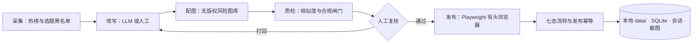

# ToutiaoAuto

> 一个跑在本机的浏览器自动化流水线：采集头条热榜 → AI 改写 → 配图 → 质检 → 发布，重点解决**状态一致性、发布幂等与合规闸门**。改写默认走免费大模型，长期**零大模型费用**；全流程在本机完成，登录态与密钥只存本地，不上传任何服务器。

[](https://nodejs.org)
[](https://github.com/houzhihoujue666/toutiao-auto)
[](LICENSE)
[](https://github.com/houzhihoujue666/toutiao-auto/actions/workflows/ci.yml)
[](https://toutiao-console-demo.app.workbuddy.host/?sharecode=2ZAJX4CUOH)
[](#零大模型费用)

**界面演示**：[在线预览](https://toutiao-console-demo.app.workbuddy.host/?sharecode=2ZAJX4CUOH)（点开即看，无需安装、无需登录）。启动 / 明细 / 设置三页都能翻，页面无后端、不发网络请求，数据均为模拟；演示页单独托管，不包含在本仓库内。

---

## 快速开始

需要 **Node.js ≥ 24**：

```bash
npm install
npx playwright install chromium
npm run dev
```

打开 http://127.0.0.1:5173，在启动主界面扫码登录头条账号；大模型 Key 在「设置」页填，照 [免费大模型怎么填（三步）](#免费大模型怎么填三步) 拿一把免费的就行，不用预先建 `.env`。

> 后端只监听 `127.0.0.1:8787`，页面与 `/api`、`/ws` 代理都由 Vite 提供。日常自用就是 `npm run dev` 这一个组合，细节见[启动](#启动)。

## 一次发布是怎么走的



五道工序之外，真正花功夫的是「发布不可逆」这件事：状态先落库再流转，发布前做幂等检查，成功后多信号判定，绝不因为并发误判就重发一次。

## 几个工程上的取舍

| 关注点         | 做法                                                                            |
| -------------- | ------------------------------------------------------------------------------- |
| 发布不可逆     | 七态状态机白名单 + 发布前幂等检查；并发误判纠正回 `published`，而不是重发      |
| 平台页面会变   | 选择器集中管理，`npm run selftest` 用真实浏览器逐项核对                        |
| 节奏保守       | 最小间隔 15 分钟、当日额度、同账号串行、全进程默认一次只发一条；熔断不自动恢复 |
| 多账号隔离     | 额度 / 间隔 / 熔断 / 会话 / 队列各算各的，默认不并发                          |
| 数据不出去     | SQLite、浏览器会话、API Key、截图全在 `data/`，已被 `.gitignore` 忽略          |
| 大模型不花钱   | 默认「官方 API + 免费模型」；付费路径不默认打开，网页版留作离线与兜底          |
| AI 不是随手写 | 规范驱动开发（SDD）：先变更包后代码；仓库自带 Agent Skill，AI 助手照同一套流程干活 |
| 文档能信       | 三层文档治理（常青 / 决策 / 变更 + 归档）与 ADR，冲突时**以代码和测试为准**    |

`npm run typecheck` 与 `npm test`（177 + 26 个用例）由 CI 守护；`docs/` 里 51 篇文档分主次，入口是 [`docs/INDEX.md`](docs/INDEX.md)。

## 零大模型费用

这个项目对大模型的要求很低：**把一段几百字的素材改写成自己的口吻**，不写代码、不做复杂推理、不读长文档。这类活儿，各家免费档的小模型完全够用，不用买套餐、不用充值、也不用显卡。

所以从本版起，**默认改写方式改为「官方 API + 免费模型」**（智谱 `glm-4.7-flash`）：程序直接发一条网络请求，不打开网页、不用登录、不怕平台改版。配上默认免 Key 的 Wikimedia Commons 图源，整条流水线跑下来**大模型费用为 0 元**。

措辞说准一点是「**零大模型费用**」：头条账号、电费、你自己准备的素材本来就不花钱，但本项目不替任何厂商承诺「永久免费」——免费档会调整、会限流，哪家变了就在设置页换一家。完整清单与官网路径见 [免费大模型获取指南](docs/30-operations/免费大模型获取指南.md)。

| 你可能会担心 | 实际情况 |
| --- | --- |
| 要花钱吗 | 用免费模型不花钱；付费模型也能填，但**默认不走付费路径** |
| Key 会不会泄露 | 只存本机 `data/app.db`，不上传；项目不内置任何共享 Key |
| 免费模型够不够用 | 只做短文本改写，够用；相似度超标会自动重写一次，仍不合格转人工复核 |
| 免费档限流怎么办 | 429 带预算自动重试，超预算转人工；也可随时换一家模型 |
| 网页版还能用吗 | 能，设置页把「改写方式」切回 `web` 即可，留作离线和兜底 |

> 第一次用只需三步：注册 → 创建 Key → 粘到设置页。照着 [免费大模型怎么填（三步）](#免费大模型怎么填三步) 走，两分钟能跑通；设置页也放了同样的一份引导卡片。

## 规范驱动开发（SDD）与 AI Harness

这个项目的代码大部分是与 AI 协作完成的，但不是「把需求扔给 AI 随手写」的 vibe coding——**规矩和图纸先写进仓库，AI 只在轨道上跑**。

| 词 | 大白话 | 在本项目里的落点 |
| --- | --- | --- |
| SDD（规范驱动开发） | 先写清「要什么、为什么、怎么验收」，AI 照单干活，写完对着单子验收 | 每个功能一个变更包 `docs/changes/NNNN-xxx/`：需求（EARS 句式 + Non-Goals）→ 设计（≥2 个备选方案的权衡）→ 任务 → 验证 → 发布，五阶段各有门禁，不过不许进下一步 |
| Harness（给 AI 套的缰绳） | 把流程、红线、模板、检查全部固化在仓库里，AI 每次进来走同一条轨道 | [`docs/00-guide/开发流程.md`](docs/00-guide/开发流程.md) 开篇即写明「智能体按本文件执行，人按本文件验收」；10 条红线、7 份阶段模板、CI + 177 + 26 个测试当质量门 |

配套两件事：

- **三层文档治理**：常青（随代码更新）/ 决策（ADR，冻结）/ 变更（批准即冻结）+ 归档，51 篇文档分主次，入口 [`docs/INDEX.md`](docs/INDEX.md)；文档与代码冲突时**以代码和测试为准**。
- **自带 Agent Skill**：仓库里放了 [`.agents/skills/toutiao-auto-feature/`](.agents/skills/toutiao-auto-feature/SKILL.md)，遵循 Agent Skills 开放标准。用 Claude Code / Codex / Cursor 等 AI 助手加新功能时，它会自动加载这套流程执行，不用每次重写提示词。

这套思路与 GitHub Spec Kit 等主流 SDD 工具一脉相承：constitution（红线）→ specify（需求）→ plan（设计）→ tasks（任务）→ implement → converge（对照验收）。区别是本仓库不依赖任何 CLI 工具——**流程本身就是仓库的一部分**。

## 使用边界（请先读）

- 这是**个人自用的本地工具**，不是绕过平台规则的工具，也不提供任何账号安全保证。
- 发布内容请自行对真实性、版权与合规性负责，遵守目标平台服务条款。
- 不收集、不上传登录态与 API Key；**请勿把 `data/` 提交进仓库或分享给他人**。
- 按「现状」提供，作者不对使用后果负责。完整说明见[免责声明与合规须知](#免责声明与合规须知)。

## 仓库结构

npm workspaces 单体仓。代码分三个包，文档、演示与运行期数据各自独立，**根目录不放任何运行期产物**：

```text
ToutiaoAuto/
├── shared/         前后端共享的类型、常量、配置
├── backend/        Fastify API、Playwright 浏览器编排、SQLite、自检脚本
├── frontend/       React + Vite 控制台（启动主界面 / 明细 / 设置）
├── e2e/            Playwright 端到端测试
├── docs/           三层文档体系（常青 / 决策 / 变更 + 归档），入口 INDEX.md
├── data/           运行时生成：数据库、登录会话、截图（已被 .gitignore 忽略）
├── package.json    workspaces 根 + 统一脚本入口
├── .agents/        AI 助手技能（Agent Skills 开放标准，加新功能自动走 SDD 流程）
├── .github/        CI 工作流（typecheck + test）
├── LICENSE / CONTRIBUTING.md / SECURITY.md
└── README.md / CHANGELOG.md
```

想读代码从 `shared/` → `backend/` / `frontend/` 这条线看起；想看设计决策去 `docs/decisions/`；完整文档地图在 [`docs/INDEX.md`](docs/INDEX.md)。
根目录那几个文件为什么必须留在根，见[根目录文件（为什么必须在根）](#根目录文件为什么必须在根)。

## 往下读

| 想做什么       | 看哪几节                                                                                                                                                                                       |
| -------------- | ---------------------------------------------------------------------------------------------------------------------------------------------------------------------------------------------- |
| 跑起来 / 改配置 | [环境要求](#环境要求) · [首次安装](#首次安装) · [启动](#启动) · [端口与配置](#端口与配置) · [常用命令](#常用命令)                                                                            |
| 了解实现       | [项目简介](#项目简介) · [功能特性](#功能特性) · [技术栈](#技术栈) · [根目录文件说明](#根目录文件为什么必须在根)                                                                          |
| 配大模型 / 不花钱 | [零大模型费用](#零大模型费用) · [免费大模型怎么填（三步）](#免费大模型怎么填三步) · [免费大模型获取指南](docs/30-operations/免费大模型获取指南.md) |
| 参与协作       | [文档与流程](#文档与流程) · [规范驱动开发（SDD）与 AI Harness](#规范驱动开发sdd与-ai-harness) · [贡献](#贡献) · [`CONTRIBUTING.md`](CONTRIBUTING.md) · [`SECURITY.md`](SECURITY.md)                                                                                  |
| 日常使用       | [运行期数据](#运行期数据) · [多账号](#多账号) · [头条登录](#头条登录) · [发布节奏](#发布节奏) · [模式与开关](#模式与开关设置页可改) · [零大模型费用](#零大模型费用)                                    |
| 出问题了       | [调试小贴士](#调试小贴士) · [故障排查](#故障排查)                                                                                                                                                 |
| 许可与声明     | [免责声明与合规须知](#免责声明与合规须知) · [License](#license)                                                                                                                                    |

<details>
<summary>完整章节目录（按文中出现顺序）</summary>

**首屏**

- [快速开始](#快速开始)
- [一次发布是怎么走的](#一次发布是怎么走的)
- [几个工程上的取舍](#几个工程上的取舍)
- [零大模型费用](#零大模型费用)
- [规范驱动开发（SDD）与 AI Harness](#规范驱动开发sdd与-ai-harness)
- [使用边界（请先读）](#使用边界请先读)
- [仓库结构](#仓库结构)
- [往下读](#往下读)

**正文细节**

- [项目简介](#项目简介)
- [功能特性](#功能特性)
- [技术栈](#技术栈)
- [根目录文件（为什么必须在根）](#根目录文件为什么必须在根)
- [文档与流程](#文档与流程)
- [免责声明与合规须知](#免责声明与合规须知)
- [环境要求](#环境要求)
- [首次安装](#首次安装)
- [启动](#启动)
- [端口与配置](#端口与配置)
- [常用命令](#常用命令)
- [运行期数据](#运行期数据)
- [多账号](#多账号)
- [头条登录](#头条登录)
- [发布节奏](#发布节奏)
- [调试小贴士](#调试小贴士)
- [模式与开关](#模式与开关设置页可改)
- [免费大模型怎么填（三步）](#免费大模型怎么填三步)
- [故障排查](#故障排查)
- [贡献](#贡献)
- [License](#license)

</details>

---

## 项目简介

ToutiaoAuto 帮你把「刷热榜 → 想选题 → 改写 → 配图 → 发文」这套重复劳动自动化。它不是一个 SaaS，而是一个**跑在你自己电脑上的本地应用**：

1. **采集**：抓取头条热榜话题下的微头条作为素材（带选题黑名单过滤）。
2. **改写**：默认用免费大模型（智谱 `glm-4.7-flash`）把素材改写成原创口吻；也可换 DeepSeek / 硅基流动 / 网页版 / 本地模拟 / 人工粘贴。
3. **配图**：自动匹配无版权风险的配图（默认 Wikimedia Commons，零注册零 Key）。
4. **质检**：相似度比对、合规检查，不达标不发布。
5. **发布**：经浏览器自动化（Playwright）自动登录、填写、发布，全程截图留证。

配套还有一套完整的**文档治理体系**（`docs/`）；界面可以直接在[在线预览](https://toutiao-console-demo.app.workbuddy.host/?sharecode=2ZAJX4CUOH)里翻，演示页单独托管、不包含在本仓库内。

想先看界面再决定要不要装？点 [在线预览](https://toutiao-console-demo.app.workbuddy.host/?sharecode=2ZAJX4CUOH) 就能直接翻三页，不用装、不用登录；演示页是纯静态的，不连后端、不发网络请求，所有数据都是模拟的。

## 功能特性

- **全自动流水线**：采集 → 改写 → 配图 → 质检 → 发布，一条龙；也支持在「待复核」阶段人工把关后再发。
- **多账号运营**：一个进程同时管理多个头条账号，额度 / 间隔 / 熔断 / 会话 / 队列各自独立，互不影响。
- **发布节奏可控**：最小发布间隔、当日额度上限、并发账号数全部可调，内置风控缓冲（默认同账号串行、全进程一次只发一条）。
- **零大模型费用**：默认「智谱免费模型 + 官方 API」，改写一段几百字不花钱；付费模型、网页版 DeepSeek、人工粘贴、本地模拟也都能一键切换。
- **真实登录态**：扫码登录，登录态落盘，过期会被准确识别并拦截，不拿假登录蒙混。
- **全程留证**：每个任务发布成功截图、失败原因（中文 + 阶段前缀 + 处理建议）、改写稿与日志全部可查。
- **本机优先 / 隐私友好**：数据库、登录态、API Key 都只存本地 `data/`，不上传。
- **自检与排障**：`npm run selftest` 用真实浏览器逐项核对选择器，`npm run smoke` 冒烟，`npm run e2e` 端到端。

## 技术栈

| 层        | 技术                                                            |
| --------- | --------------------------------------------------------------- |
| 前端      | React 19 + React Router 7 + Vite 7 + TypeScript                 |
| 后端      | Node.js + Fastify 5（HTTP/WebSocket）+ TypeScript + tsx 运行    |
| 浏览器自动化 | Playwright 1.64（Chromium）                                   |
| 数据库    | SQLite（better-sqlite3），单文件本地存储                        |
| 图片处理  | sharp（裁剪 / 压缩 / 合成）                                     |
| 校验      | zod；日志 pino；测试 vitest + @playwright/test                  |
| 工程化    | npm workspaces + Prettier + concurrently                        |

## 根目录文件（为什么必须在根）

| 文件 | 为什么不能放子目录 |
| ---- | ------------------ |
| `package.json` `package-lock.json` | workspaces 声明（`shared`/`backend`/`frontend`）与依赖解析起点；锁文件必须与它同级 |
| `.npmrc` `.prettierrc.json` `.prettierignore` | npm 项目级配置只认「与 `package.json` 同级」那一份；Prettier 从被格式化文件所在目录**向上查找**配置 |
| `.gitignore` | git 只读仓库根这份（含 `data/`、登录态、本地草稿） |
| `tsconfig.base.json` | 被三个包 `extends`，放根是社区惯例 |
| `README.md` `CHANGELOG.md` `LICENSE` `CONTRIBUTING.md` `SECURITY.md` | 托管平台首页直接渲染；平台与社区约定从仓库根读取 |

其余都已经各归各位：`playwright.config.ts` 在 `e2e/`（`npm run e2e` 已带 `--config`），
文档在 `docs/`（地图见 [`docs/INDEX.md`](docs/INDEX.md)）。根目录不带任何运行期产物。

## 文档与流程

新功能统一按「需求 → 设计 → 开发 → 验证 → 发布 → 沉淀」走，一次功能一个变更包 `docs/changes/NNNN-xxx/`；
文档分三层（常青 / 决策 / 变更 + 归档），已定案的文档冻结、只以新文档取代，不再原地改写。

| 我想……                 | 去哪                                                                       |
| ---------------------- | -------------------------------------------------------------------------- |
| 看文档地图             | [`docs/INDEX.md`](docs/INDEX.md)                                           |
| 看规范与阶段门禁       | `docs/00-guide/`                                                           |
| 看红线（开工前必读）   | [`docs/10-architecture/红线与约束.md`](docs/10-architecture/红线与约束.md) |
| 看当前实现与已知差异   | [`docs/20-reference/实现现状与已知差异.md`](docs/20-reference/实现现状与已知差异.md) |
| 查某个决定为什么这么定 | `docs/decisions/README.md`                                                 |
| 查历史设计文档（冻结） | `docs/archive/legacy/FROZEN.md`                                            |
| 查这次版本改了什么     | [`CHANGELOG.md`](CHANGELOG.md)                                             |
| 想参与协作 / 提 PR     | [`CONTRIBUTING.md`](CONTRIBUTING.md)                                       |
| 报安全问题             | [`SECURITY.md`](SECURITY.md)                                               |

> 文档与代码冲突时，**以代码和测试为准**，并按常青层规则就地更新 `README.md` / `docs/20-reference/`；
> 决策层（ADR）与变更包已冻结，不原地改写，差异只在「实现现状与已知差异」里登记。

## 免责声明与合规须知

> **请务必先读这一段，再决定是否使用。**

- 本项目是一个**个人自用**的本地自动化工具，用于降低重复性运营劳动。**它不是为了绕过平台规则而设计，也不鼓励任何违规操作。**
- 使用本工具发布内容，请你**自行对内容真实性、版权与合规性负责**，遵守《今日头条用户协议》及相关法律法规；请勿发布虚假信息、侵权内容或违反平台规范的内容。
- 任何浏览器自动化都存在**账号风控 / 限流 / 封号**的潜在风险。本项目已内置发布间隔、额度上限、串行发布等缓冲措施，**但无法保证账号绝对安全**，风险由使用者自行承担。
- 本项目**不收集、不上传**任何你的账号信息、登录态或 API Key——它们只存放在你本机的 `data/` 目录。但也意味着：**请勿把 `data/` 提交进仓库或分享给他人**（已被 `.gitignore` 忽略）。
- 本项目按「现状」提供，**不提供担保，作者不对使用造成的任何后果负责**。

## 环境要求

- **Node.js** ≥ 24
- **Playwright Chromium**（首次安装后需执行：`npx playwright install chromium`）
- Windows / macOS / Linux 均可；本仓库在 Windows 上开发验证

## 首次安装

```bash
npm install
npx playwright install chromium
```

> 如需配置 LLM API Key、图库 Key 等，运行后在前端「设置」页填写即可，无需预先创建 `.env`。

## 启动

### 一键起前后端（开发推荐）

```bash
npm run dev
```

- 前端：http://127.0.0.1:5173
- 后端：http://127.0.0.1:8787（API；浏览器访问需经前端代理）
- 前端会把 `/api`、`/ws` 反代到后端，不用处理跨域

### 分别启动

```bash
npm run dev:backend   # 只起后端
npm run dev:frontend  # 只起前端
```

### 生产模式构建

```bash
npm run build                 # 构建前端到 frontend/dist
npm run start                 # 只启动后端（API / WebSocket，8787）
```

> **注意**：后端**不托管静态页面**，`frontend/dist` 不会由 8787 端口提供。
> `vite.config.ts` 里的 `/api`、`/ws` 代理只在开发服务器（dev server）生效，`vite preview` 并没有配这项代理。
> 所以目前可用的组合是：

| 目的                   | 命令                                                        |
| ---------------------- | ----------------------------------------------------------- |
| 日常自用（推荐）       | `npm run dev`（Vite 同时提供页面与代理）                    |
| 后端不热重载           | `npm run start` + `npm run dev:frontend`（页面与代理仍由 Vite 提供） |
| 只验证构建产物能否打开 | `npm run preview --workspace @tou/frontend`（接口需另配反向代理） |

## 端口与配置

| 用途            | 默认                    | 环境变量         |
| --------------- | ----------------------- | ---------------- |
| 后端 HTTP/WS    | `127.0.0.1:8787`        | `PORT`           |
| 前端 dev server | `127.0.0.1:5173`        | `WEB_PORT`       |
| 前端代理到后端  | `http://127.0.0.1:8787` | `BACKEND_ORIGIN` |
| 数据根目录      | 仓库根 `data/`          | `DATA_DIR`       |

后端只绑本机，不对外暴露。可用 `DATA_DIR` 把运行时数据（数据库、会话、截图）放到任意路径。

## 常用命令

| 命令                   | 作用                               |
| ---------------------- | ---------------------------------- |
| `npm run dev`          | 前后端并发启动（热重载）           |
| `npm run dev:backend`  | 仅起后端                           |
| `npm run dev:frontend` | 仅起前端                           |
| `npm run build`        | 构建前端                           |
| `npm run start`        | 启动后端（生产）                   |
| `npm test`             | 运行所有 workspace 的单元/集成测试 |
| `npm run typecheck`    | 全量 TypeScript 类型检查           |
| `npm run lint`         | Prettier 风格检查                  |
| `npm run format`       | Prettier 自动格式化                |
| `npm run selftest`     | 平台选择器自检（开浏览器逐项核对） |
| `npm run smoke`        | 冒烟脚本                           |
| `npm run seed`         | 灌入演示素材（本地模拟数据，可重复执行） |
| `npm run e2e`          | Playwright 端到端测试              |

## 运行期数据

都在 `data/` 目录（默认仓库根，**首次启动自动创建**，可用 `DATA_DIR` 覆盖）：

- `data/app.db` — SQLite 主数据库（账号、素材、任务、配置、日志）
- `data/sessions/<账号名>/` — 每个账号一个浏览器用户数据目录（含登录态 cookie）
- `data/media/<任务ID>/` — 每条任务的原始图 / 输出图 / 库存图
- `data/shots/<任务ID>/` — 任务执行截图留证

清空 `data/` 等同于重置系统（账号、素材、任务会清空，需重新登录）。

## 多账号

一个进程可以同时管理多个头条账号，每个账号**独立**：额度、最小发布间隔、熔断器、浏览器会话、发布队列各算各的，一个账号掉登录或熔断不影响别的账号。

界面目前只有**三个页面**，账号相关操作全部集中在启动主界面：

| 页面           | 路径           | 能做什么                                                                                                                                 |
| -------------- | -------------- | ---------------------------------------------------------------------------------------------------------------------------------------- |
| 启动主界面     | `/`            | 每账号一行：登录态、今日已发 / 剩余、队列 / 待质检 / 失败数，以及扫码登录、检查登录态、发布条数、发布、切换、删除、退出登录、恢复熔断；页面顶部可新建账号 |
| 明细           | `/list/:type`  | 素材池、待复核、待发布、已发布、失败、全部任务六个分页；顶部可切换账号                                                                   |
| 设置           | `/settings`    | 只放可调参数、提示词模板、外部大模型 / 图库、锁定项与红线展示，**不管理头条账号**                                                       |

- 每个账号都要自己扫一次码（程序不代注代填）；切账号时会释放上一个账号的浏览器省内存，登录态在硬盘，切回来不用重扫
- 同一账号内部永远串行发布（同一时刻只有一条在发）；「同时发布的账号数」默认 **1**（即全进程一次只发一条），调大会提高风控风险
- 账号处于「发布中」（有待发布队列）、离线、熔断或当日额度耗尽时，它的「发布」按钮会禁用或换成「扫码登录」

删除账号有保护：**至少要留一个账号**，且**已经产出过任务的账号不许删**（已发布内容必须留证）。
删除只清库记录，`data/sessions/<账号名>/` 保留。

## 头条登录

1. 打开 http://127.0.0.1:5173/（启动主界面，账号都在这页）
2. 找到你要登录的那一行，点行内的「**扫码登录**」
3. 程序会打开一个**有头浏览器窗口**显示头条二维码，用头条 App 扫那个窗口里的码
4. 状态变成「已登录」后会话自动保存到 `data/sessions/<账号名>/`

> 二维码图片同时通过 WebSocket 推送（`qr` 消息），但当前界面**没有二维码弹层**，请以弹出的浏览器窗口为准。
> 已经登录的会话再点「扫码登录」会收到 `ALREADY_LOGGED_IN` 提示；要换号先点「退出登录」。

登录态用「能否打开发布页看到正文编辑器」验证（不止看有没有头像元素），过期会被准确识别为「已失效」并拦截后续发布。

## 发布节奏

- 两条发布之间最少间隔 `minPublishIntervalMin`（默认 15 分钟）：发布队列会按这个间隔自动发
- 一天上限 `dailyPublishLimit`（默认 50），达到后发起发布会被拒（连任务都不建）
- 点「发布」时如果距上次发布还不到间隔，前端会先算出还需等待的分钟数并提示，避免刚发完就连发
- 后端 `GET /api/summary` 会返回 `nextPublishAt`（下一条最早可发时间），但**当前界面没有倒计时组件**；需要的话直接看接口返回或日志

## 调试小贴士

- 看实时日志：顶栏「实时日志」抽屉（WebSocket 推送），或观察启动后端的终端 / `GET /api/logs`
- 看具体任务：明细页任务行点「复核」→ 原文、改写稿、相似度、质检结果、配图与来源；点「留证」看发布记录
- 选择器失效了：`npm run selftest` 会打开真实浏览器逐项核对，截图存到 `data/shots/selftest/`
- 怀疑数据库被搞坏：先备份再删 `data/app.db`，重启即可（账号、素材、任务会清空，浏览器会话保留）

## 模式与开关（设置页可改）

- **运行模式** `runtime.mode`：`simulated` 走模拟数据；`real` 走真实浏览器
- **同时发布的账号数** `accountConcurrencyLimit`：多账号时的跨账号并发上限，默认 `1`；调大会提高风控风险（同一账号内部始终串行）
- **真实发布** `allowRealPublish`：仅当 `real` 模式才生效，关掉后只走 Dry Run 存草稿
- **改写方式** `llm.mode`：`api` 调用 OpenAI 兼容接口（**默认**，配免费模型即零费用）；`web` 操作网页版 DeepSeek（旧默认，需登录一次，留作离线与兜底）；`manual` 人工粘贴；`simulated` 本地模拟
- **选题黑名单** `crawl.blockedTopics`：每行一类、逗号分隔同义词；命中的素材采集时丢弃

## 免费大模型怎么填（三步）

改写方式默认已经是 `api`，地址和型号也已预填成免费那套，**只差一把免费 Key**。设置页的「免费 AI 改写」卡片里放了同样的三步，技术参数收在折叠区，不懂编程也能照着做。

1. **注册**：打开 [智谱开放平台](https://open.bigmodel.cn/)（或 `www.bigmodel.cn`），手机号注册登录即可。官网可能提示实名认证，但按[官方实名认证 FAQ](https://docs.bigmodel.cn/cn/faq/authentication-issues)（2026-11-14 核对）「目前调用 API 并不强制要求实名认证」，官方只是建议；页面没要求可以跳过，真要求了照提示完成一次即可——那是官网流程，与本项目无关。
2. **拿 Key**：进控制台 → 「API Keys / API 密钥管理」 → 「添加新的 API KEY」，起个名字创建后**立刻复制**（多数平台只完整显示一次）。
3. **填进设置页**：在「可调设置」里把 `llm.api.key` 粘进去，点「填好了，测试一下」，看到「连接正常」就通了。地址 `https://open.bigmodel.cn/api/paas/v4` 与模型名 `glm-4.7-flash` 已默认填好，不用自己敲。

只要服务端兼容 `POST {baseUrl}/chat/completions`，都能直接接。常见的可替换项：

| 服务商 | `llm.api.baseUrl` | `llm.api.model` | 费用说法（智谱 2026-11-14 复核，其余 2026-11-11 核对） |
| --- | --- | --- | --- |
| 智谱 GLM（默认） | `https://open.bigmodel.cn/api/paas/v4` | `glm-4.7-flash` | 免费模型，中文短文本够用 |
| DeepSeek | `https://api.deepseek.com/v1` | `deepseek-chat` | 按量计费 |
| 硅基流动 | `https://api.siliconflow.cn/v1` | `Qwen/Qwen2.5-7B-Instruct` | 以官网免费模型列表为准 |
| 阿里百炼 | `https://dashscope.aliyuncs.com/compatible-mode/v1` | `qwen-plus` | 新用户有免费额度，注意有效期 |
| 火山方舟 | `https://ark.cn-beijing.volces.com/api/v3` | 控制台里的模型 ID | 以官网免费额度为准 |

**别替厂商打包票**：免费政策、限流与模型名会变，上表只是入口索引，实际以各官网「模型 / 价格」页为准。完整路径、常见报错与换模型的步骤见 [免费大模型获取指南](docs/30-operations/免费大模型获取指南.md)。Key 只存在本机 `data/app.db`，不上传、不内置任何共享 Key。

## 故障排查

| 现象                         | 处理                                                     |
| ---------------------------- | -------------------------------------------------------- |
| 前端 5173 打开是空白         | 看后端 8787 是否在跑；检查 `data/` 下错误日志            |
| 启动报「选择器缺必填项」     | `backend/src/config/selectors/*.ts` 有字段缺失，回看提交 |
| 点发布报 `CRAWL_DOM_EMPTY`   | `npm run selftest`，按截图修选择器                       |
| 点发布报 `RATE_LIMITED`      | 距离上次发布还没到间隔，等够再点                         |
| 扫码登录失败                 | 终端里有 `LOGIN_QR_*` 日志，按提示操作                   |
| 发布报 `PUBLISH_FAILED`      | 失败截图在任务详情；按日志修发布页选择器                 |

## 贡献

本项目以个人维护为主，欢迎 issue 与 PR。开工前请先读 [`CONTRIBUTING.md`](CONTRIBUTING.md)，里面写清了红线、变更包流程、提交前检查与文档治理规则。

一句话版：**红线是硬约束，代码与文档同步改，文档与代码冲突时以代码和测试为准。**

涉及登录态、Key 或漏洞的问题，请按 [`SECURITY.md`](SECURITY.md) 的渠道反馈，不要开公开 Issue 贴敏感信息。

## License

本项目采用 [MIT License](LICENSE) 开源。

你可以自由使用、复制、修改、合并、发布、分发、再授权乃至商用，唯一条件是：在副本或实质性部分中保留版权声明与许可声明。软件按「原样」提供，不作任何明示或暗示的担保；因使用本软件产生的任何主张、损害或责任，作者不承担责任。

> **使用边界**：本工具仅在本机运行，不上传登录态与密钥；发布动作设有人工复核、限速与熔断，并强制作品声明与首发闸门。请遵守目标平台的服务条款，内容合规责任由使用者自行承担，详见[免责声明与合规须知](#免责声明与合规须知)。
